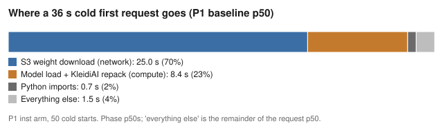
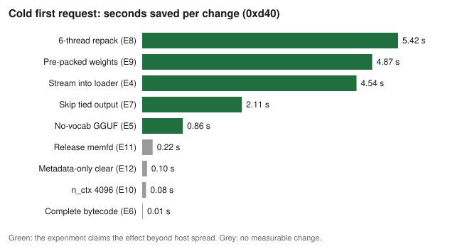
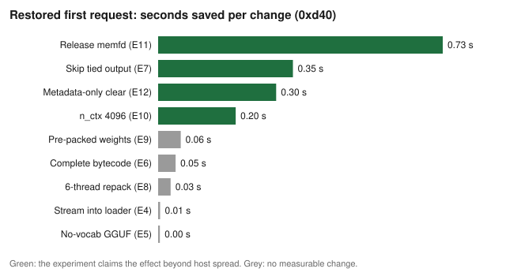
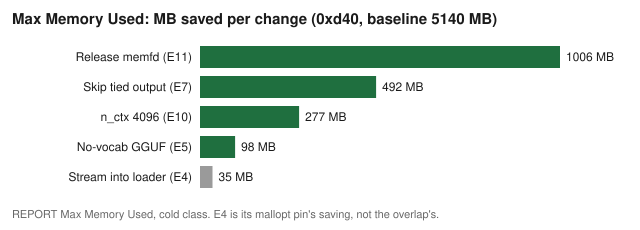
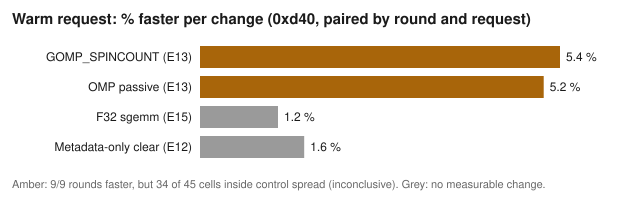

# lambda-kleidiai: ranked recommendations from the measured experiments

Recommendation document, card R (ce4d), 2026-10-25. Initiative: Lambda model-loading and latency experiments.

## Executive summary

We ran 15 one-variable experiments against P1's pinned baseline: Strands Decider 2B, Q8_0 GGUF, arm64 Lambda,
10,240 MB, python3.12, us-east-2, SnapStart on published versions. A cold first request takes 36.0 s, a request
after a SnapStart restore takes 3.95 s, and a warm request takes 0.66 s. The 25.0 s S3 weight download is 70% of
the cold request, and no change we tested makes it faster.

We recommend six changes. Each one is a single switch or file, keeps every answer bit-identical, and lowers
Lambda cost:

1. Cold start: repack weights with six threads (E8, -5.4 s) or ship pre-packed weights (E9, -4.9 s). Both attack
   the same 8.4 s repack, so pick one per deployment, then skip the unused tied output head (E7, -2.1 s).
2. SnapStart restore: release the weight memfd before the snapshot (E11, -0.73 s and -1,006 MB), clear only cache
   metadata between requests (E12, -0.31 s), and set n_ctx to the 4,096-token model window (E10, -0.20 s and
   -277 MB).

We do not recommend S3 Express One Zone (E1), One Zone-IA (E2), other download strategies (E3), the concat and
sgemm kernel changes (E14, E15), or any tokenizer change (T1, T2, T3). Each either fell inside run-to-run spread or
cost more. The OpenMP spin setting (E13, -5.4% warm) is consistent in direction but not yet separated from host
spread, so it goes to the ladder for re-measurement rather than to production.

These numbers are single-change effects. They overlap: E8 and E9 replace each other, E4's download overlap shrinks
once loading is fast, and SnapStart already hides every cold-path gain from restores. The performance ladder
(below) measures the combinations, one rung at a time, before any combined number is claimed.

Decisions:

1. Approved on 2026-10-22: the operator approved the Lambda ladder that starts from these six changes, with a
   budget of $150 per day in playground1 us-east-2.
2. Open: choose E8 or E9 for production after the ladder measures both on the same rung. E9 needs a build-time
   packing step and a matching loader. E8 is one environment variable.
3. Open: ship the Lambda-only switches (E4, E11, E12, E13) as opt-in Lambda settings, not general defaults, as
   "Lambda versus general deployments" sets out.

## How to read the numbers

- Every delta is candidate minus control, p50, within CPU part 0xd40 as read from `/proc/cpuinfo`. Lambda placed
  every run on three CPU parts (0xd40, 0xd0c, 0xd4f) and gives no control over placement (H1). 0xd40 is the only
  part with enough samples in every start class. Other parts appear with their sample counts and are never pooled
  into a headline. No CPU part is mapped to a processor generation.
- Brackets are 95% bootstrap intervals published by each experiment. E4, E5 and E9 published per-round medians
  instead of intervals. Their effects are larger than the control's per-round range in every round.
- An effect counts only when the experiment's own host-spread rule passed. Otherwise it ranks as "no measurable
  change", even if its interval excludes 0.
- Baseline run-to-run spread (P1, per-round medians, coefficient of variation): cold 0.35%, restore 2.6%, warm
  5.4%.
- `rank.py` derives every number on this page from the pinned result files in `sources/`. `ranking.json` holds the
  full set, including every CPU part.

## Where the time goes

| Start class | Baseline p50 | Largest phase | Phase share |
|---|---|---|---|
| Cold first request | 35.99 s | S3 weight download, 25.04 s | 70% |
| Restored first request | 3.95 s | Lambda Restore Duration, 3.27 s | 83% |
| Warm request | 0.66 s | Matmul (KleidiAI i8mm), P3 profile | 49% of CPU |

## Cold start: ranked changes

| Rank | Change | Cold first request | 0xd0c / 0xd4f | Cold model load | Correctness |
|---|---|---|---|---|---|
| 1 | E8 six-thread repack | -5.42 s [-5.49, -5.32] | -14.50 s / -4.83 s | -5.48 s | 1,800/1,800 identical |
| 2 | E9 pre-packed weights | -4.87 s (per-round) | -8.22 s / -4.46 s | -4.91 s | 600/600 identical |
| 3 | E4 stream into loader | -4.54 s (per-round) | -9.26 s / -3.97 s | overlapped | 600/600 identical |
| 4 | E7 skip tied output head | -2.11 s [-2.20, -2.01] | -4.85 s / -1.80 s | -2.05 s | 1,200/1,200 identical |
| 5 | E5 GGUF without vocabulary | -0.86 s (per-round) | -1.51 s / -0.70 s | -0.66 s | 600/600 identical |

Samples per arm on 0xd40 are 36 to 45. The 0xd0c and 0xd4f columns rest on 2 to 12 samples per arm and confirm
direction only. Every cold gain is compute (load and repack). No change moved the download: E4 overlaps the load
with it, it does not shorten it.

## SnapStart restore: ranked changes

| Rank | Change | Restored first request | 0xd0c | Mechanism | Correctness |
|---|---|---|---|---|---|
| 1 | E11 release memfd pages | -0.73 s [-0.78, -0.65] | -0.89 s | Smaller snapshot, shorter Restore Duration | 1,200/1,200 identical |
| 2 | E7 skip tied output head | -0.35 s [-0.39, -0.30] | -0.47 s | 540 MB less packed weight | 1,200/1,200 identical |
| 3 | E12 metadata-only clear | -0.31 s [-0.35, -0.24] | -0.38 s | No memset of restored cache pages | 840/840 identical |
| 4 | E10 n_ctx 4096 | -0.20 s [-0.23, -0.17] | -0.20 s | 288 MiB less K/V cache | c4096 bit-identical to P1 |

The cold-start changes (E4, E5, E8, E9) do not change restores. SnapStart runs the download and the load inside
`publish_version`, before the snapshot, so a restore never repeats them.

## Memory

| Change | Max Memory Used (baseline 5,140 MB) | Share |
|---|---|---|
| E11 release memfd pages | -1,006 MB [-1,007, -996] | -19.5% |
| E7 skip tied output head | -492 MB [-495, -489] | -9.5% |
| E10 n_ctx 4096 | -277 MB [-279, -275] | -5.4% |
| E5 GGUF without vocabulary | -98 MB (per-round) | -1.9% |

Lower memory shrinks the SnapStart snapshot. It does not lower the configured 10,240 MB, which buys the six vCPUs
the forward needs.

## Warm requests

| Change | Warm REPORT Duration, paired by round and request | Status |
|---|---|---|
| E13 GOMP_SPINCOUNT=30000 | -5.4% mean, 9 of 9 rounds faster, 34 of 45 cells inside control spread | Inconclusive |
| E13 OMP_WAIT_POLICY=passive | -5.2% mean, 9 of 9 rounds faster, 33 of 45 cells inside control spread | Inconclusive |
| E15 llamafile F32 sgemm | -1.2% mean, inside 1.0% control noise | No change |
| E12 metadata-only clear | ratio 0.984 [0.969, 1.002] | No change |
| E13 OMP_WAIT_POLICY=active | +55.3% | Do not use |

E14 (row-split concat) fell inside the control's spread in all 35 cells. No warm change is ready for production.

## Cost

Compute changes leave S3 cost unchanged: the same 2.08 GB, 31 ranged GETs and 1 HEAD per download. Prices are P1's
us-east-2 table.

| Change | Lambda duration, per 1,000 cold starts | SnapStart cache, per version-month (proxy) |
|---|---|---|
| E8 | -$0.72 | none |
| E9 | -$0.65 | none |
| E4 | -$0.61 | none |
| E7 | -$0.28 | -$1.87 |
| E5 | -$0.11 | -$0.37 |
| E11 | none on cold | -$3.83 |
| E10 | none on cold | -$1.06 |
| E1 S3 Express | +$1.19 (+24% total) | none |
| E2 One Zone-IA | +$20.80 S3 retrieval | none |

Lambda does not bill Restore Duration as compute time. SnapStart bills per GB restored and per GB-second cached.
The cache column uses memory saved as a stand-in for snapshot size, which no run measured directly.

## Network: no measured gain

| Change | Cold weight download | Verdict |
|---|---|---|
| E1 S3 Express, no VPC | -0.76 s, 5 of 5 rounds | Not adopted: +0.02 s with AZ held fixed, +24% cost |
| E2 One Zone-IA | ratio 1.002 [0.998, 1.005] | No change, +$20.80 per 1,000 downloads |
| E3 eight other strategies | 2 no change, 6 slower (up to +11.4 s) | Keep 32 threads x 64 MiB |

Every arm ran near 80 MiB/s, the per-environment network rate. The 25 s download stays the largest cold-start
bottleneck. SnapStart is the measured way around it: a restore reads no weights.

## Tokenizer track (T0 to T3)

The deployed tokenizer is already compiled: Hugging Face `tokenizers` 0.23.2, a Rust core behind PyO3. T0 measured
its share of each start class. T1, T2 and T3 were cancelled at their evidence gates on operator decision, so none
of them has its own measurement.

| Option | Largest possible gain (T0 ceiling) | Tradeoffs | Recommendation |
|---|---|---|---|
| No change | none | none | Recommended |
| T1 optimise Python code | under 0.2% of a warm request: Python is 2% of tokenizer samples | none worth the parity risk | Not pursued |
| T2 compiled hot paths | already compiled. Only `from_file` (0.83 s cold) remains | new native build per arm64 target | Not pursued |
| T3 other library | up to 0.83 s of on-demand cold init, 0 s on restore | 20 MB vocabulary, license and parity checks | Not pursued |

Tokenizer-only figures: warm encode p50 0.83 ms (0.12% of the handler), cold `Tokenizer.from_file` p50 0.83 s
(at most 2.3% of the cold request, 0% of Init Duration), restored first request 1.3% of the handler by mean. Every
end-to-end option sits inside run-to-run spread, so "no change" ranks first.

## How the changes combine

| Pair | Interaction | Expected combined effect |
|---|---|---|
| E8 + E9 | Both remove the same repack | Not additive. Measure both on one rung |
| E7 + E8 or E9 | E7 removes the tied head that E9 still repacks | Additive in part |
| E4 + any load change | E4 hides load time inside the download | Gain shrinks as load shrinks |
| Cold changes + SnapStart restore | Restores skip download and load | No restore gain |
| E11 + E7 | Different memory: memfd pages versus packed weights | Additive in part |
| E10 + E12 | Both reduce the cache-clear cost | Overlap |
| E13 + load changes | Warm path only | Independent |
| E6 bytecode + E4 | Imports matter once the download no longer binds | Re-measure on the ladder |

## Lambda versus general deployments

The same llama.cpp engine can run outside Lambda: on EC2, in a container, or on a laptop. A change ships as a
general default only if it helps or holds there too. If it could slow a non-Lambda host, it ships as a Lambda
opt-in setting.

| Change | Scope | Why |
|---|---|---|
| E8 six-thread repack | General | Load-time only. Same packed bytes at 1, 2, 3 and 6 threads |
| E9 pre-packed weights | General, with its loader | Needs E9's loader and a KleidiAI-capable CPU |
| E7 skip tied output head | General, decshim only | Safe only while nothing asks llama.cpp for logits |
| E10 n_ctx 4096 | General | Equals the model window. Refuses no JevBench task |
| E5 GGUF without vocabulary | General, decshim only | Only for engines that tokenize outside llama.cpp |
| E6 complete bytecode | General | Packaging hygiene |
| E4 stream into loader | Lambda opt-in | Pays only when weights arrive over the network at load |
| E11 release memfd pages | Lambda opt-in | Only for a memfd-backed GGUF before a snapshot |
| E12 metadata-only clear | Lambda opt-in | Gain is SnapStart first touch. Proven only at llama.cpp f74e2fa6a |
| E13 OpenMP spin count | Lambda opt-in | Measured only under Lambda's CPU share |

Every "general" row still needs a measurement on a fixed non-Lambda host before it becomes a default. That is the
general ladder in the follow-up items.

## Performance ladder

Status: planned. Measurement starts after this page publishes, on fork branch `lkai/ce4d-ladder` cut from P1's
pinned baseline `70eab7b`. Each rung adds one measured winner, and every rung runs interleaved against both the
pinned baseline and the previous rung. Null and negative rungs are published too, as `R-ladder/*` runs on the P2
dashboard.

| Rung | Adds | Source branch @ SHA | Question it answers |
|---|---|---|---|
| L1a | E8 | `lkai/5a61-parallel-repack` @ `bef9c89` | Cold load, env switch |
| L1b | E9 (alternative to L1a) | `lkai/f1ee-prepacked` @ `5dce29d` | Cold load, build-time packing |
| L2 | E7 on the better of L1a and L1b | `lkai/f768-skip-output-repack` @ `0af73df` | Does E7 still pay after E8 or E9? |
| L3 | E4 | `lkai/7cb8-stream-load` @ `d540365` | What overlap is left once load is fast? |
| L4 | E11 | `lkai/f989-release-memfd` @ `1495fb3` | Restore and memory on top of E7 |
| L5 | E12 + E10 together and apart | `lkai/1683-cache-clear` @ `ab60069`, `lkai/fbb1-kv-size` @ `60f4586` | Overlap of the two restore changes |
| L6 | E13 | `lkai/a088-omp-wait` @ `9f52dd0` | Warm gain with more cells per round |
| L7 | E6 | `lkai/fada-hotspot` @ `e989e39` | Imports once the download is overlapped |

## Follow-up implementation items

| Item | Scope | Gate |
|---|---|---|
| Ship the ladder's best measured combination as the Lambda example's defaults | Lambda | Ladder result published |
| General ladder: measure E8, E9, E7, E10, E5 and E6 on a fixed non-Lambda arm64 host | General | No regression on that host |
| Lambda opt-in profile for E4, E11, E12 and E13, off by default elsewhere | Lambda | Default build unchanged off Lambda |

The kanban cards for these items name their owners and blockers.

## Sources and reproduction

- Every experiment's result is pinned in `sources.json` (S3 key, VersionId, SHA-256) and copied under `sources/`.
  The results store is `s3://strands-decider-lkai-results-apse2` (ap-southeast-2). The dashboard is Harmony
  Artifactory artifact `aece9ccf-c1d5-4217-b31e-e5b3c78ee759`.
- Regenerate: `python examples/lambda-kleidiai/recommendations/rank.py`. Check that the committed outputs are
  current: `python examples/lambda-kleidiai/recommendations/rank.py --check`.
- Superseded and excluded: P3 run 20261020T124451Z (one pooled Lambda client lost 45 restore invokes). P3's
  replacement run 20261020T231634Z is used.

## Limitations

- 0xd0c and 0xd4f rest on 2 to 18 samples per arm, so they confirm direction, not size.
- Cold and restore waves ran one arm after the other inside each round (E1 to E12). Arm order alternated between
  rounds, which balances round-level drift but not drift within a round.
- E8's "improved" status uses a minimum-sample rule disclosed after the results were seen. Its pre-registered rule
  gives "inconclusive" because of one stratum with 2 samples. Its 0xd40 effect has the same sign in every round.
- E10's status is "no-change" under an all-parts rule because 0xd0c and 0xd4f have too few restores. Its 0xd40
  intervals exclude 0.
- Snapshot size was not measured directly. The cache-cost column uses Max Memory Used as a stand-in.
- Not observed in any Lambda run, so unknown: CPU implementer, variant and revision, feature flags, HWCAPs, cgroup
  limits, kernel, AZ and physical host.
